# Stass Accounting — Business Bookkeeping & Financial ERP Platform

<p align="center">
  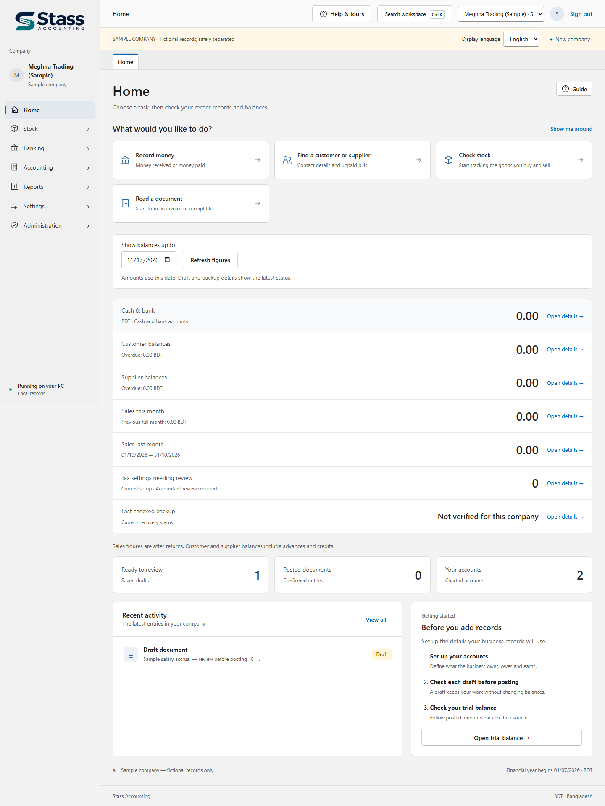
</p>

Stass Accounting is an enterprise-grade, offline-first double-entry accounting and ERP system engineered specifically for trading enterprises. Built with zero-compromise financial precision, the application features an atomic double-entry posting engine, real-time moving-average stock valuation, automated bank reconciliation, an in-browser commercial invoice designer, local OCR document intake, and native bilingual English and Bengali operations.

---

## System Interface Gallery

### Financial Dashboard & Workspace Navigation
<table><tr>
<td valign="top" width="50%"></td>
<td valign="top" width="50%">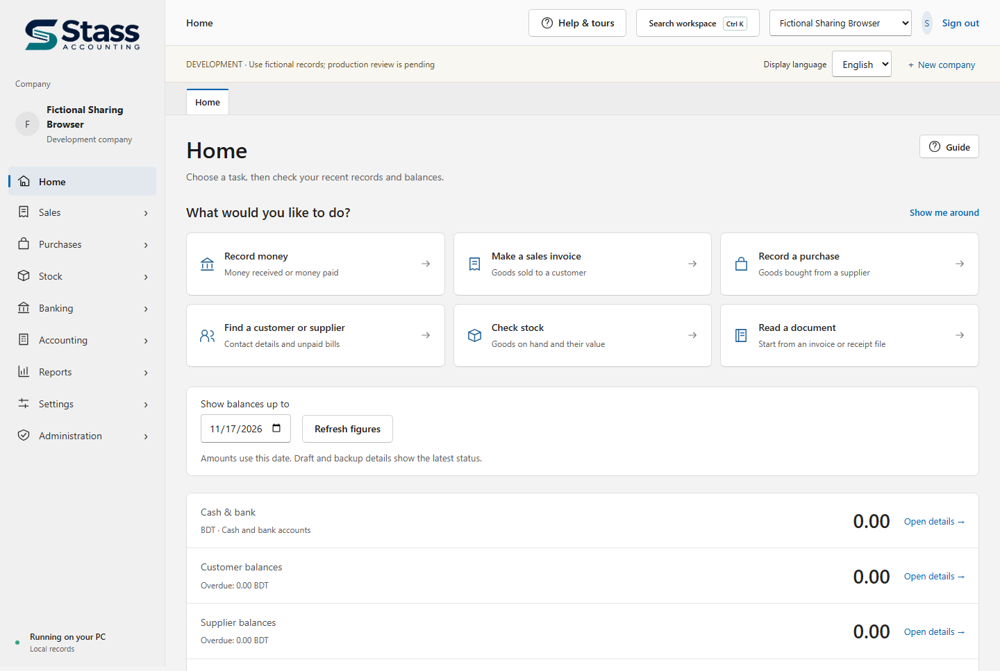</td>
</tr></table>

- **Executive Financial Dashboard:** Provides business owners with instant visibility into aggregate cash position, customer receivables, supplier payables, monthly sales performance, pending invoice reviews, and system backup integrity.
- **Workspace Navigation Hub:** Organizes the enterprise workflow across nine categorized business domains: Home, Sales, Purchases, Stock, Banking, Accounting, Reports, Settings, and Administration. Navigation dynamically respects user roles and granular permissions.

### Commercial Invoicing & Template Customization
<table><tr>
<td valign="top" width="50%">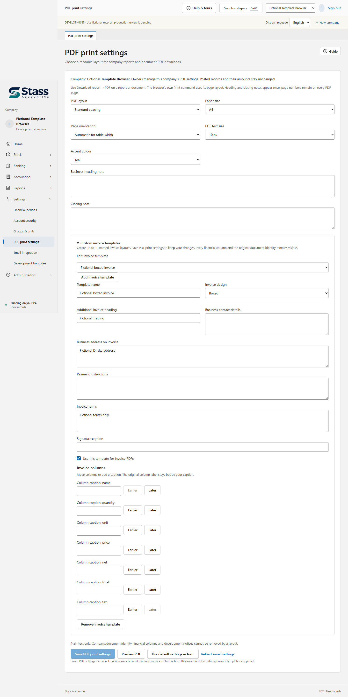</td>
<td valign="top" width="50%">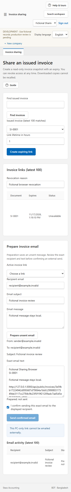</td>
</tr></table>

- **Invoice Template Designer:** A visual layout customizer allowing companies to configure multi-column commercial invoice templates, custom header typography, payment instructions, and PDF print presets.
- **Controlled Invoice Sharing:** Generates expiring, revocable read-only invoice snapshot links and prepares structured email communication while keeping production database instances isolated from external networks.

### Banking & Statement Reconciliation
<table><tr>
<td valign="top" width="50%">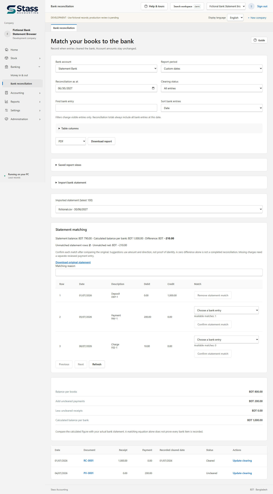</td>
<td valign="top" width="50%">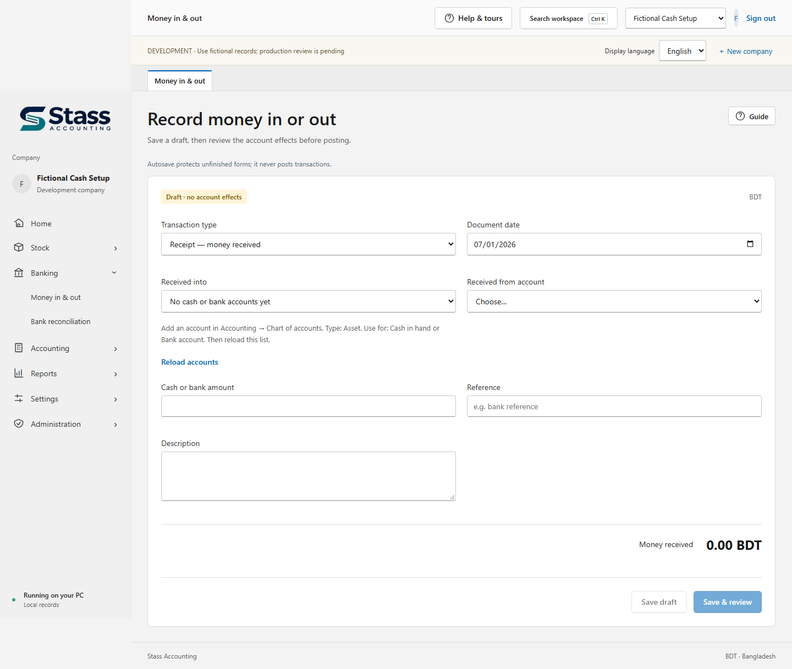</td>
</tr></table>

- **Bank Statement Reconciliation:** Ingests external bank statement CSVs, preserves raw statement integrity, and supports audited two-way matching against recorded ledger disbursements and receipts with discrepancy tracking.
- **Contextual Financial Setup:** In-app operational guidance that assists operators in configuring chart-of-accounts classifications, cash drawers, and bank accounts without abandoning active drafts.

### Financial Reporting & Ledger Integrity
<table><tr>
<td valign="top" width="50%">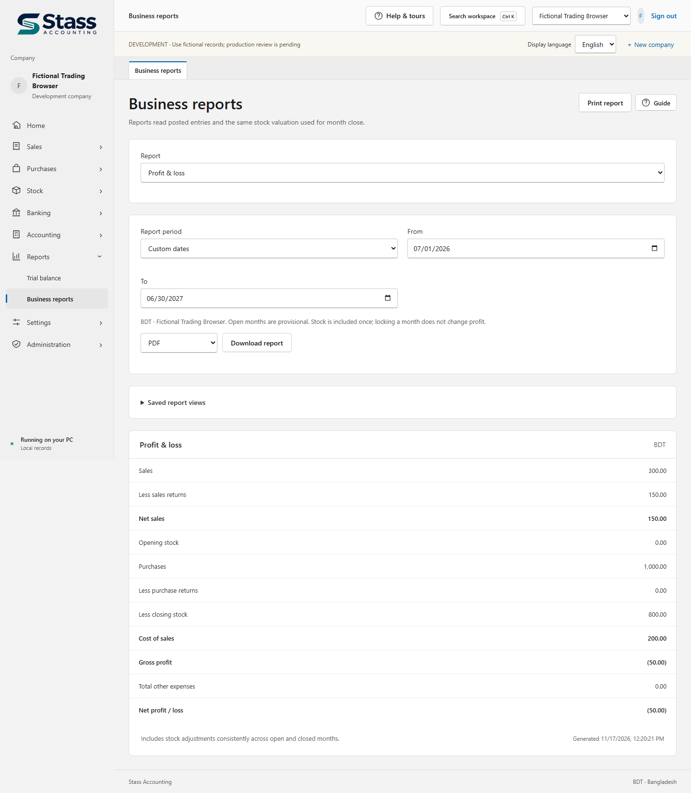</td>
<td valign="top" width="50%">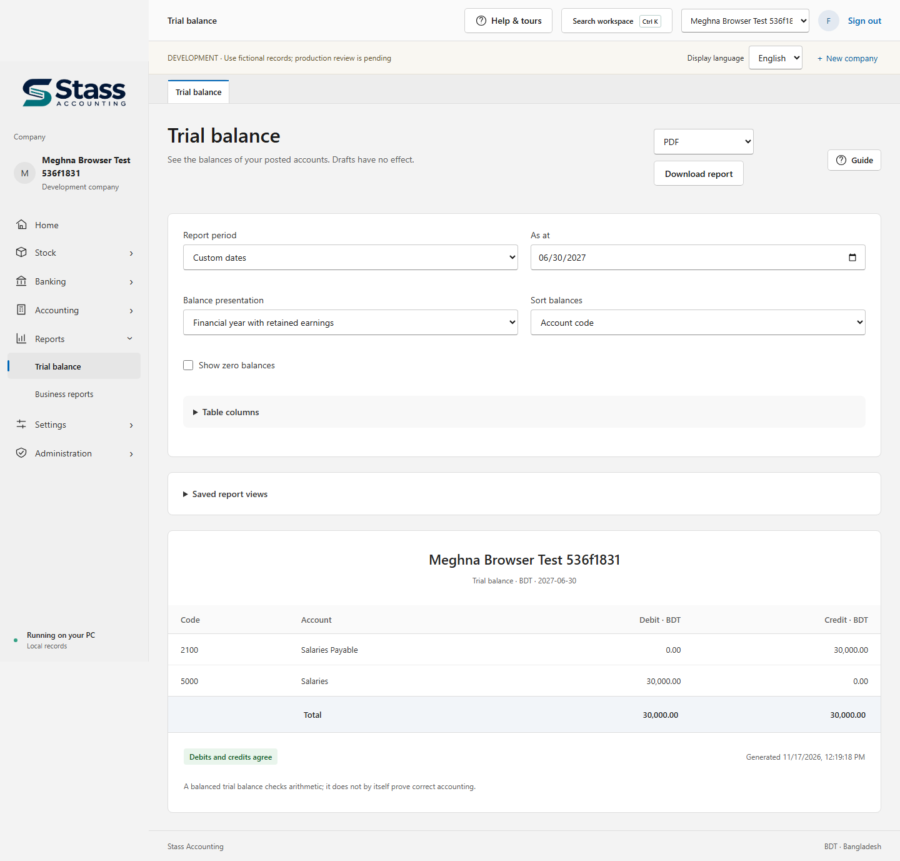</td>
</tr></table>

- **Profit and Loss Statement:** Computes multi-period operational revenue, cost of goods sold (COGS), gross margins, and operational overheads with full drill-down to underlying journal postings.
- **Trial Balance & Ledger Verification:** Real-time debit and credit verification enforcing zero imbalance across all asset, liability, equity, income, and expense ledgers with fiscal year continuation.

### Inventory, Stock Valuation & Staged Data Intake
<table><tr>
<td valign="top" width="50%">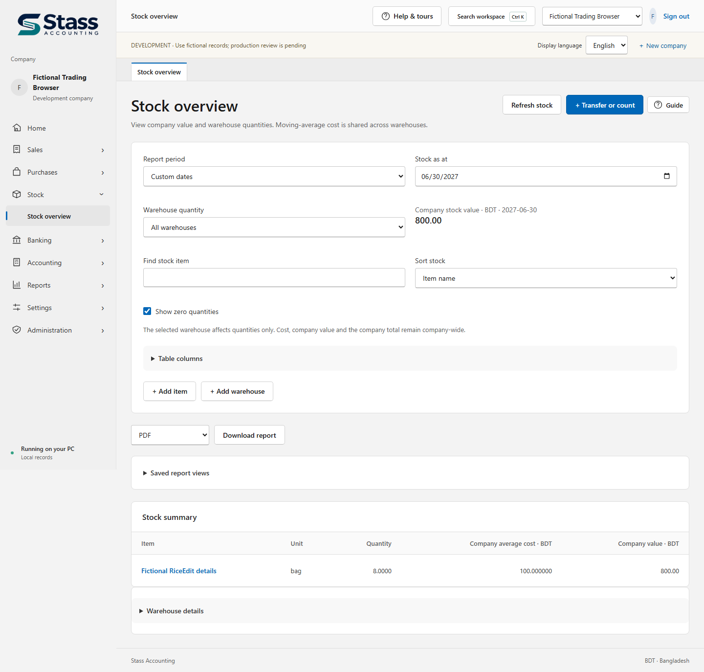</td>
<td valign="top" width="50%">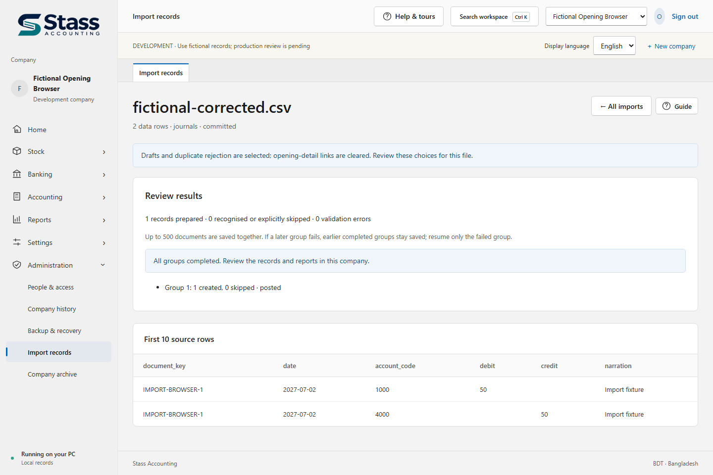</td>
</tr></table>

- **Perpetual Stock & Valuation:** Tracks inventory balances across multiple physical warehouses using weighted moving-average unit costing, automated stock adjustment journals, and financial period locks.
- **Staged Import Pipeline:** Validates high-volume CSV, XLSX, and JSON master data and transaction groups before ledger submission, catching duplicate entries and schema mismatches in an isolated sandbox.

### Localization & Interactive Operational Guides
<table><tr>
<td valign="top" width="50%">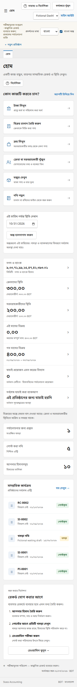</td>
<td valign="top" width="50%">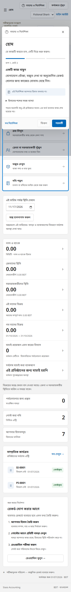</td>
</tr></table>

- **Native Bilingual Support:** Complete English and Bengali user interface utilizing embedded Noto Sans Bengali typography, localized numerals, cultural date formatting, and taka currency conventions.
- **Interactive In-App Guided Tours:** 49 built-in operational tours explaining navigation routes, accounting conventions, and document lifecycles without mutating database records.

---

## Key Capabilities

- **Immutable Financial Ledger:** Business journals and transaction postings cannot be modified or hard-deleted. Ledger corrections strictly follow formal accounting standards through linked reversal and replacement records.
- **Deterministic Decimal Arithmetic:** Enforces arbitrary-precision arithmetic across backend services and database storage, eliminating IEEE 754 floating-point rounding errors in commercial transactions.
- **Perpetual Moving-Average Costing:** Dynamically recalculates item unit valuation upon purchase receipt posting, maintaining accurate cost-of-goods-sold figures across warehouse transfers and sales.
- **Local OCR Document Intake:** Embedded client-side OCR engine that scans printed receipts, bills, and invoices into structured review drafts with SHA-256 document fingerprinting.
- **Multi-Tenant Security Architecture:** Database-level Row-Level Security (RLS) policies guarantee strict company isolation across multi-user environments.
- **Disaster Recovery Validation:** Automated daily backup operations with scheduled isolated restoration verification drills that test ledger invariants and count integrity before discarding test instances.

---

## Technical Stack

- **Frontend Interface:** React 19, TypeScript, Vite, Tailwind CSS, Lucide Icons
- **Backend Services:** Fastify (Node.js 24), TypeScript, Kysely (Type-Safe SQL Query Builder)
- **Database Engine:** PostgreSQL 16 with Row-Level Security (RLS)
- **OCR & Document Processing:** Tesseract.js, pypdfium2, Local Noto Sans Bengali Font
- **Testing & Verification:** Playwright (End-to-End browser automation), Vitest, Axe Core (Accessibility)
- **Infrastructure & Storage:** Docker Compose, AES-256-GCM Encrypted Backup Archives

---

## System Architecture

```text
+-------------------------------------------------------------+
|                  Browser Client (React 19)                  |
|  - TypeScript Single-Page Application                       |
|  - Bilingual Localization (English / Bengali)               |
|  - 49 Interactive Workflow Guides                           |
|  - Client-Side Form State Recovery & Password Screening     |
+------------------------------+------------------------------+
                               | JSON over HTTPS / REST
+------------------------------v------------------------------+
|                Backend API Service (Fastify)                |
|  - Fastify Modular Architecture & Security Plugins          |
|  - Kysely Type-Safe Query Construction                      |
|  - Arbitrary-Precision Decimal Accounting Engine            |
|  - Local Document OCR Engine & PDF Generation               |
+------------------------------+------------------------------+
                               | RLS-Scoped Connection Pool
+------------------------------v------------------------------+
|                Database Engine (PostgreSQL 16)              |
|  - Row-Level Security (RLS) Multi-Tenant Boundary           |
|  - Atomic Journal Posting & Reversal Chains                 |
|  - Immutable Audit Event Ledger                             |
+------------------------------+------------------------------+
                               | Scheduled Snapshots
+------------------------------v------------------------------+
|              Disaster Recovery & Ops Worker                 |
|  - Scheduled AES-GCM Encrypted Backup Archives              |
|  - Isolated Test Database Restoration Drills                |
|  - Automated Ledger Invariant & Balance Auditing            |
+-------------------------------------------------------------+
```

---

## Core Engineering Principles

- **Offline-First Resilience:** Designed to execute on local enterprise workstations without external internet dependencies or telemetry, safeguarding company financial privacy.
- **Zero-Trust Restoration:** Backups are continuously validated through isolated restore drills that verify row counts, ledger invariants, and audit chains in disposable databases.
- **Separation of Concerns:** Business logic and authorization reside exclusively within the backend service layer, enforcing authorization checks on every state transition.

---

## Intellectual Property Notice

This repository serves exclusively as a portfolio demonstration. The underlying source code, configuration files, and proprietary business logic remain strictly confidential and are not distributed as open-source software. Unauthorized reproduction, modification, or redistribution of any materials within this repository is strictly prohibited.

All rights reserved.
